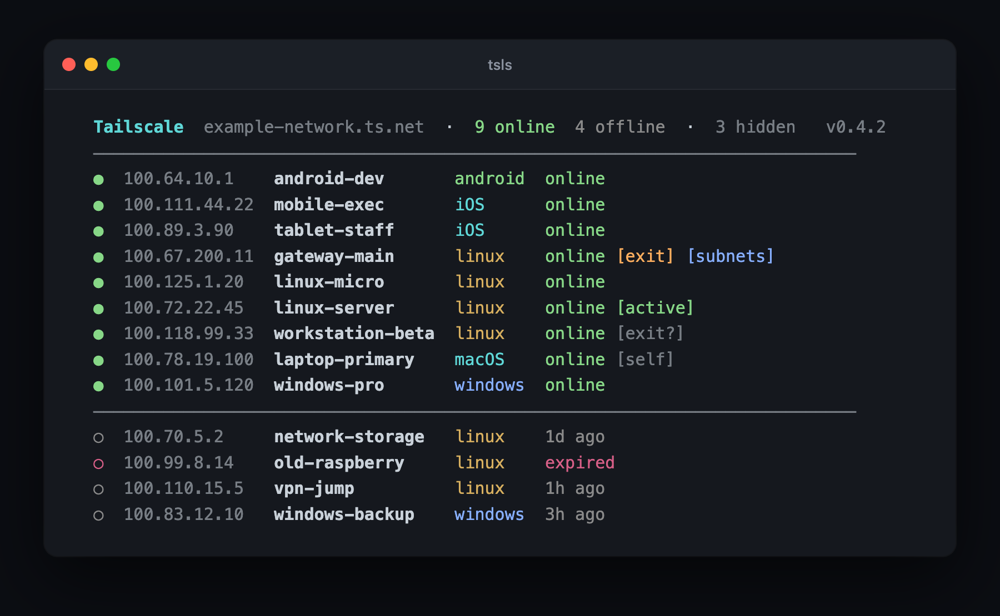

# better-tailscale-ls

A nicer `tailscale status`. Colored, sorted, filterable, with online/offline
counts and badges for `[self]`, `[active]`, and `[exit]` nodes.




## Install

One-liner (curl):

```bash
curl -fsSL https://raw.githubusercontent.com/cobanov/better-tailscale-ls/main/install.sh | bash
```

Or manual:

```bash
curl -fsSL https://raw.githubusercontent.com/cobanov/better-tailscale-ls/main/tsls \
  -o ~/.local/bin/tsls && chmod +x ~/.local/bin/tsls
```

The installer drops `tsls` into `~/.local/bin` (or `/usr/local/bin` if that
isn't on your PATH). Override with `PREFIX=/some/dir`.

### Dependencies

- [`tailscale`](https://tailscale.com/download) CLI
- [`jq`](https://jqlang.github.io/jq/)
- `bash` 4+ (macOS ships 3.2; the script still works there)

On macOS:

```bash
brew install tailscale jq
```

## Usage

```bash
tsls             # your devices, online first (Mullvad + shared-in nodes hidden)
tsls -o          # online only
tsls -f          # offline only
tsls -a          # also include Mullvad exit nodes and shared-in devices
tsls -w          # watch mode, refreshes every 5s
tsls -w 2        # custom refresh interval
tsls -u          # self-update to the latest release
tsls -V          # print version
tsls --help
```

If you're connected to Mullvad through Tailscale, the ~70 exit nodes
(`us-sea-wg-001`, `de-fra-wg-302`, ...) would otherwise drown out your
own devices. They're hidden by default, together with shared-in
(sharee) placeholder entries, and counted in the header (`78 hidden`);
use `-a` / `--all` to see them.

The current version is shown dim in the header so you always know what
you're running, and `tsls -u` pulls the newest tagged release over
itself (uses `sudo` if the install dir isn't user-writable).

### Badges

- `[self]` this machine
- `[active]` peer with an active connection right now
- `[exit]` the exit node you are currently using
- `[exit?]` offers itself as an exit node
- `[subnets]` advertises subnet routes

### Colors

OS gets a color so you can scan the list quickly: macOS/iOS cyan, linux yellow,
windows blue, android green, everything else magenta. Online dots are green,
offline dots dim. Devices whose node key has expired count as offline and
show a rose `expired` status until they re-authenticate.

## Uninstall

```bash
rm ~/.local/bin/tsls   # or wherever you installed it
```

## License

MIT, see [LICENSE](LICENSE).
